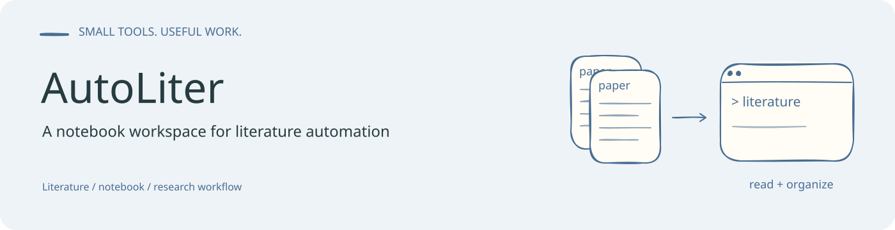

# AutoLiter

一个以 Jupyter Notebook 为入口的文献整理原型：从 Markdown 提取 DOI、查询 Crossref 元数据，并整理题录。Notebook 也保留了 PDF 获取的历史实验代码。

## 使用入口

打开 [`AutoLiter.ipynb`](AutoLiter.ipynb)，按单元格检查输入路径和需要执行的步骤。

```bash
python -m pip install requests beautifulsoup4 jupyterlab
jupyter lab AutoLiter.ipynb
```

主要组件包括：

- `extract_doi`：从 Markdown 文本提取 DOI。
- `crossrefInfo`：根据 DOI 或标题查询 Crossref 元数据。
- `pdfDownload`：Notebook 中的历史下载辅助类。
- `SST.md`、`SST1.md`：已有 Markdown 示例与整理内容。

## 展示与复现

本轮准备使用 DOI 提取及题录整理的小样例生成结果展示，运行环境确认后补充图像、运行命令和输入说明。此处暂不展示未经实际运行的结果。

Notebook 中不同单元格可能采用不同输入文件；执行前请检查路径。元数据查询需要网络，外部下载入口的可用性不属于本仓库的稳定保证。

## 许可

见 [`LICENSE`](LICENSE)。条幅的可编辑源文件为 [`assets/readme/banner.excalidraw`](assets/readme/banner.excalidraw)。
